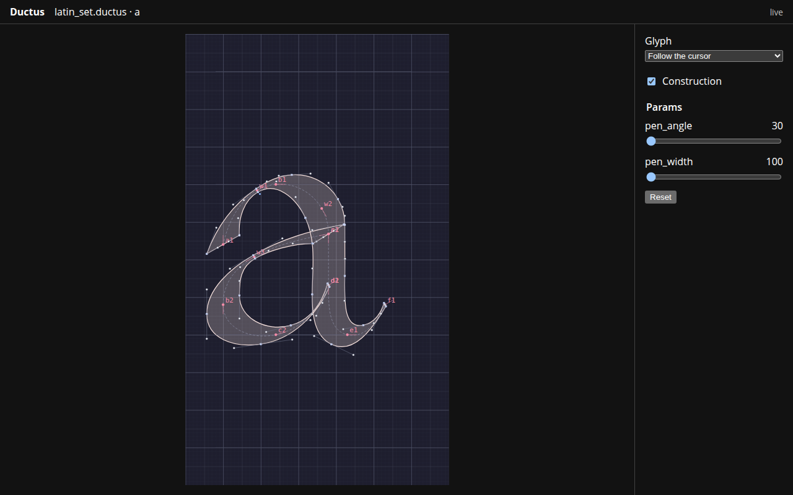

# Working in an editor

The playground is a fine place to sketch: nothing to install, a slider for every param, a picture that redraws as you type. A font, though, soon outgrows a single buffer. It becomes a handful of files that import a shared foundation, kept in version control and edited in your own editor. Ductus follows you there. Its language server, `ductus lsp`, checks your code as you type, tells you what names mean and what they evaluate to, and serves a page that draws the glyph under your cursor while you write it.

This chapter sets that up with Neovim and then walks through the loop it gives you.

## Setting up

Install the `ductus` binary from the repository; the language server is one of its commands:

```sh
cargo install --path crates/ductus-cli
```

Neovim 0.11 or later starts it for `.ductus` files with a few lines in `init.lua`:

```lua
vim.filetype.add({ extension = { ductus = "ductus" } })

vim.lsp.config("ductus", {
  cmd = { "ductus", "lsp" },
  filetypes = { "ductus" },
  root_markers = { ".git" },
})
vim.lsp.enable("ductus")

-- Comments are `#` to the end of the line; `gc` needs to know.
vim.api.nvim_create_autocmd("FileType", {
  pattern = "ductus",
  callback = function() vim.bo.commentstring = "# %s" end,
})
```

The last few lines are for Neovim rather than the language server: `gc` comments lines out with the buffer's `commentstring`, which Neovim leaves empty for a language it doesn't know. That is enough for everything in this chapter except the preview, which needs two more pieces: a `:DuctusPreview` command, and an autocmd that tells the server where your cursor is, since the protocol has no standard message for that. Both are about twenty lines; the [ductus-lsp README](https://github.com/ductus-lang/ductus/tree/master/crates/ductus-lsp) has them, along with inlay hints and completion as you type. Any other editor that speaks the Language Server Protocol can run `ductus lsp` too; only the preview's cursor-following needs that one editor-side addition.

## Two windows

Open a glyph file, put the cursor in a glyph, and run `:DuctusPreview`. A page opens at `http://127.0.0.1:45974/` (45974 spells "glyph" on a phone keypad). Put it on a second screen, or beside the editor, and leave it there.

<figure class="screenshot">
  
</figure>

From then on the page follows you:

- **It shows the glyph you are in.** Move the cursor from `glyph a` into `glyph b`, and the page switches to `b`. Move into params, a `def`, or a file you import, and it keeps the glyph you were looking at, so you can tune a shared macro and watch one of the glyphs that uses it redraw.
- **It redraws as you type,** from the unsaved buffer; there is nothing to save or rebuild. Each change is evaluated and drawn in a few milliseconds.
- **It draws the construction**: nodes with their names, the pen's extent at each, skeleton guides, fitted handles and anchors. This is the debug view of the [next chapter](debugging.md), always at hand. Untick *Construction* to see the ink alone.
- **It keeps the last good picture through a mistake.** Half-typed code, an undefined name, a contour left open: the page dims the last rendering and shows the error with its line above it, and brightens again once the code is whole.
- **Its sliders move through the design space.** There is one for each param, within its declared range. They change what the page draws and nothing else: the file keeps its defaults, and so do the values the editor shows you. It is the quick way to see whether a construction holds at the corners before you check them properly with `ductus inspect --set`.

The selector at the top of the panel pins one glyph in place, or shows all of them side by side, when following the cursor is not what you want.

## What the editor knows

While the page shows what your code draws, the editor tells you what it says.

**Errors as you type.** Every syntax error is underlined as soon as you make it, and once the syntax is whole, the first evaluation error is too: a name used before it is bound, a name bound twice in one scope, a contour that doesn't close, a point where a number belongs.

**Values where they are computed.** Hover over a name to see its declaration and its value for the default params. Turn on inlay hints and every computed number shows its value at the end of its line:

```text
stem = 40 + 0.14 * weight;  ▸ 96
hair = 0.85 * stem;  ▸ 81.6
```

This is the probe binding from the next chapter without the round trip through `ductus inspect`: write `waist = distance(…);` in a glyph and its value appears beside it. Numbers, params and metrics have values, and so do a glyph's nodes (position, direction and width), contours and guides (point counts) and anchors. Points, pens and other paths show their declaration only, for now.

**Finding your way.** Go to definition follows a name to where it is bound, including into an imported file, and on an `import` line it opens the file. Find references lists every use of a binding across your project. The document outline lists params, metrics, defs and glyphs, with each glyph's contours, guides, nodes and anchors beneath it, and a workspace symbol search finds params, metrics, defs, glyphs and top-level bindings in any file of the project.

**Writing.** Completion offers what fits where you are: `contour`, `guide` and `anchor` at the start of a statement in a glyph; names in scope, functions and the direction constants inside an expression; `pos`, `left`, `tip` and the other node fields after `n.`. Calls complete with a placeholder per argument. Inside a call, signature help shows the parameters, the current one highlighted, along with the function's description. For your own `def`s, the description is the comment directly above it. Formatting is `ductus format`, so it can run on every save.

**Renaming safely.** Rename changes a binding and every use of it, in every file. In a language where bindings never change and inner scopes may reuse outer names, a rename can quietly change what some other line means. Rename a glyph's local `w` to `stem`, and a later `advance = stem;` in that glyph would stop reading the top-level `stem`. The server checks for this, and for names bound twice in one scope, and refuses the rename with the line it would change.

## Where the playground fits

The two complement each other. The playground needs nothing installed and is the place to try an idea or share a snippet; it cannot follow imports, since a browser has no filesystem. The editor is where a font gets built: many files, imports, version control, and the same picture, redrawn as you type.
